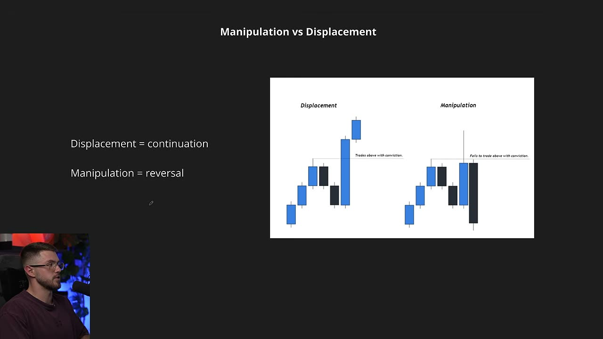
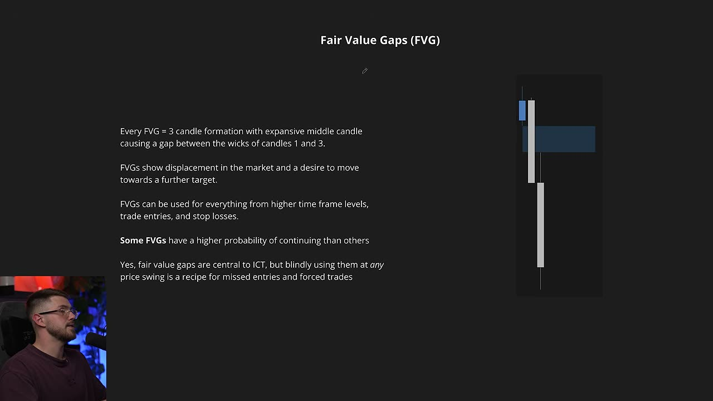
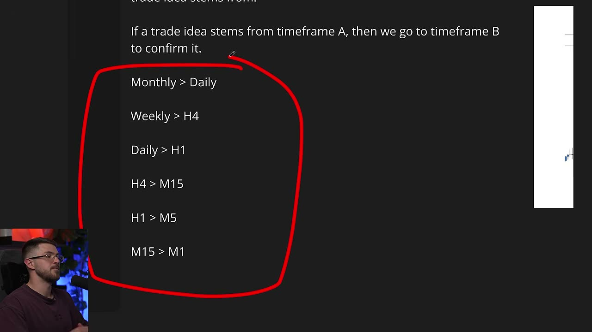
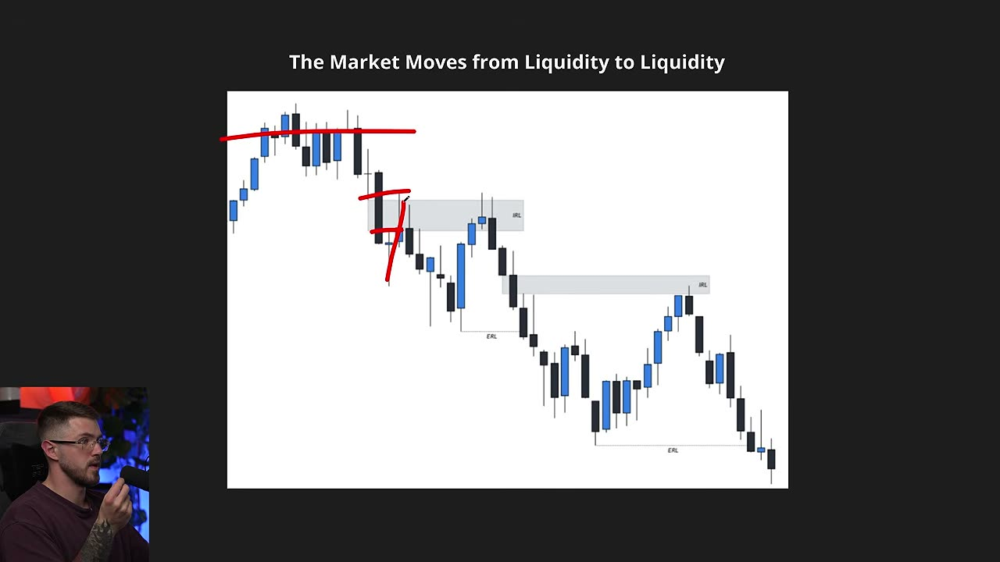

# 02 · Reading Price

## Market structure `[0:11]`
Structure is simply highs and lows. The skill is knowing **which** ones count, and the answer is the breakthrough
of this method: **structure is only valid when it comes with displacement.** `[0:12]`

## Displacement vs manipulation `[0:12]`

| | **Displacement = continuation** | **Manipulation = reversal** |
|---|---|---|
| Looks like | Energetic push through the swing point **with conviction** | Pokes through and **fails to trade beyond with conviction** |
| Footprint | Leaves a **fair value gap** | Long wick, no fair value gap, snaps back |
| Means | Smart money did not defend that level | Smart money was active in the wick |

A body close beyond a high is not enough by itself. Look for the fair value gap. `[0:13]`

### What each one targets `[0:14] [0:15]`
- **After a displacement:** expect continuation. The swing point created by the displacing leg tends to be traded
  back into later, then price carries on to the next high or low.
- **After a manipulation:** expect price to trade to the swing point that **failed to displace**.
- **Manipulation followed by displacement** is the highest-probability read of all. This pattern repeats over and
  over, so test it on your own charts. `[0:15]`

## Fair value gap (FVG) `[0:13] [0:28]`

An FVG is a **three-candle formation** with an expansive middle candle that leaves a gap between the wicks of
candles 1 and 3.
- It shows displacement and a desire to move toward a further target.
- It serves as a higher-timeframe level, a trade entry, and a stop-loss reference.
- Some FVGs have a higher probability than others. See `03-key-levels.md` for how to pick them.

## Premium & discount `[0:16]`
**If trading is a business, candles are your product.** Sell at a premium, buy at a discount.

**Setup:** TradingView Fib tool with only **1, 0.5 and 0** switched on. `[0:16]`

**Use:** draw from swing point to swing point of the latest impulse leg.
- 0.5 of the impulse = fair market value
- Above 0.5 = **premium**, below 0.5 = **discount**
- Reversals are likely to happen in premium or discount **in context of the previous price leg** `[0:18]`

**How to apply it:** price displaces down through a low → look to sell from a **fair value gap in premium**.
Price displaces up through a high → look to buy from a fair value gap in discount. Re-draw each time a new
displacing leg forms. `[0:17]`

## Timeframe alignment `[0:19]`

If the trade idea stems from timeframe A, confirm it on timeframe B:

| Idea from | Confirm on |
|---|---|
| Monthly | Daily |
| Weekly | H4 |
| Daily | H1 |
| H4 | M15 |
| H1 | M5 |
| **M15** | **M1** |

When the lower timeframe starts manipulating highs and displacing lows inside a higher-timeframe premium FVG,
the two are aligned and that is where you look to trade. `[0:18]`

## Where liquidity rests `[0:20]`
Ask: **"Where are retail traders placing their stop-losses?"**
- Highs and lows
- **Relative equal highs and lows** (very high value, more people are positioned there)
- Trendlines
- Chart patterns (bull flags are a classic pool of breakout buyers `[0:24]`)
- Psychological round numbers, such as Bitcoin at 100,000

Any **smooth edge** you can draw a line across is liquidity, and price is likely to visit it before the real move. `[0:21]`

**Always check the reaction.** Liquidity above does not mean price goes there now. If the only interaction with a
high failed to displace, price is likely to continue lower first. `[0:21]`

## Internal → external range liquidity `[0:22]`

- **Internal range liquidity (IRL):** levels **inside** a swing high to swing low range, mainly fair value gaps.
- **External range liquidity (ERL):** the **highs and lows** of the range.

> **The market always moves from internal range liquidity to external range liquidity, and back again.**

Price trades into the FVG (IRL), then runs to the high or low (ERL), creates a new range, and repeats. Fresh FVGs
in the direction of travel are evidence that the move continues. `[0:23]`

**Example, the failed bull flag:** retail buys the flag breakout, price fails to displace above the highs, then
displaces down. The FVG left behind is your IRL, and the range low is your ERL target. `[0:25]`

## Liquidity is half the equation `[0:25]`
Once you see liquidity you can never unsee it, and it instantly makes you a sharper trader. On its own it can tempt
you to see a reversal at every pool. The fix is the three pillars: `[0:26]`

1. **Where** do you trade? → key levels
2. **What** do you look for there? → confirmation
3. **When** do you trade? → time

Make these three clear and repeatable and your trading changes overnight. Much of what feels like a psychology
problem is really the absence of a clear plan. `[0:27]`
