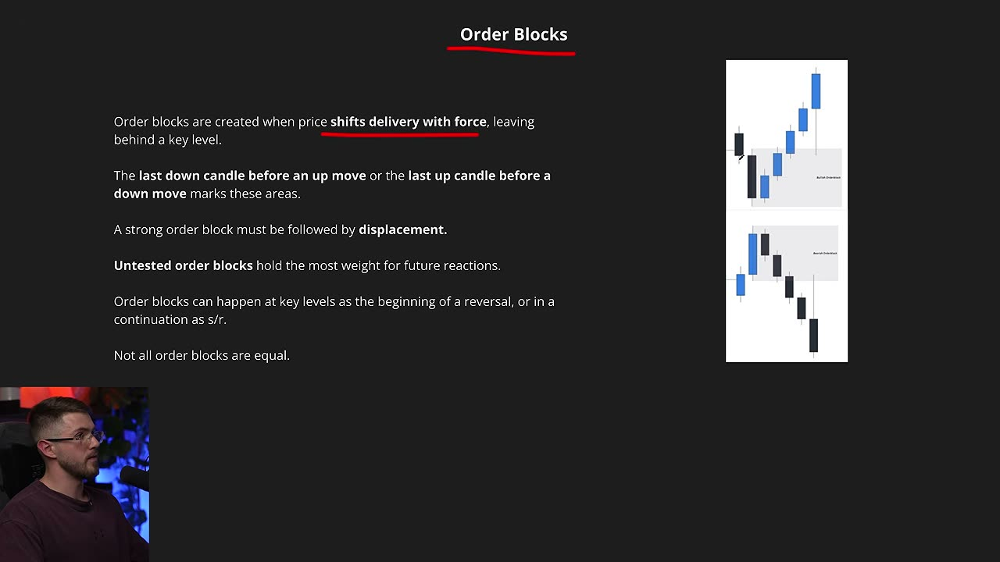
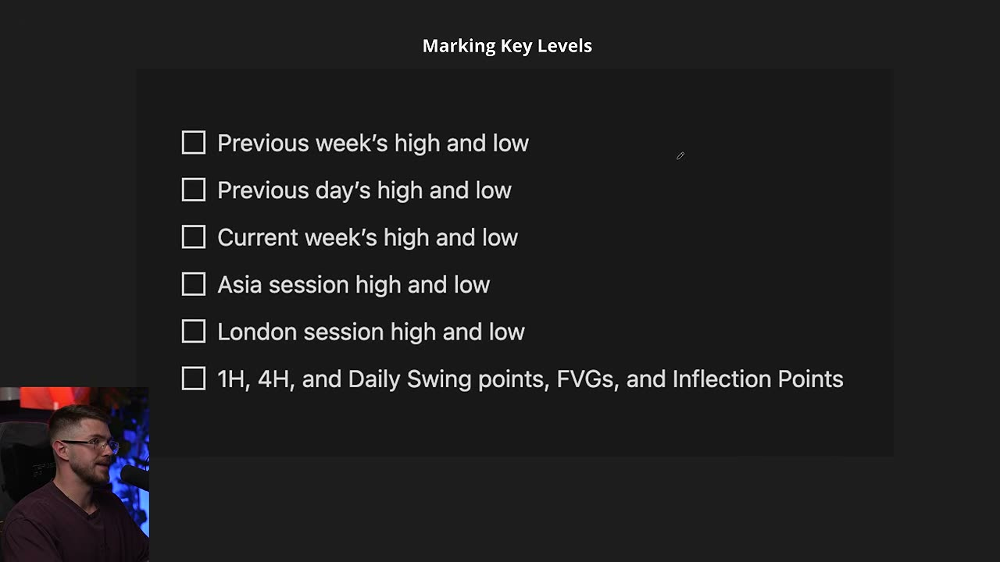
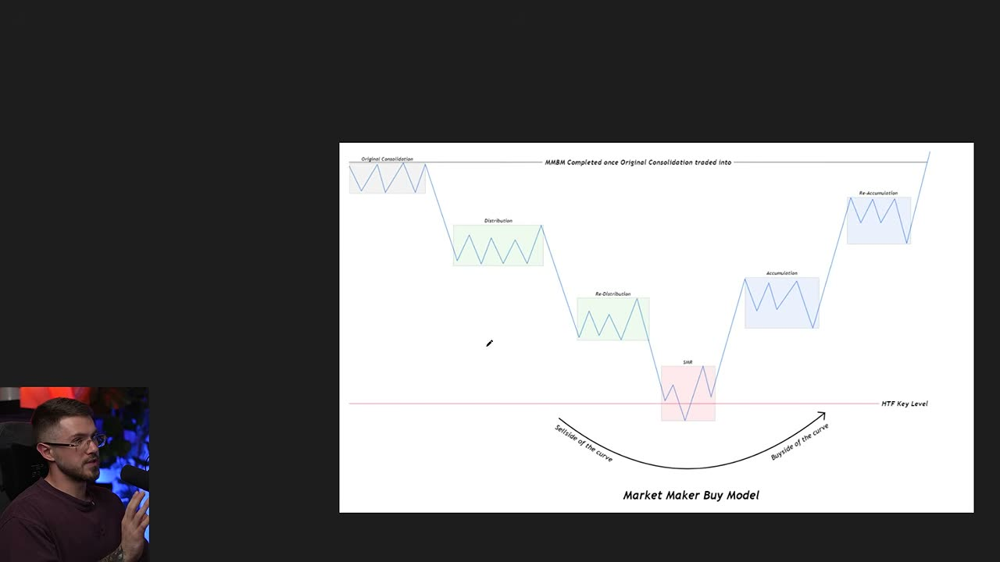

# 03 · Key Levels: Where You Do Business

**Every high-probability trade starts from a key level.** Some levels are targets, some are entries, some are
stop references. Most traders already know too many levels, so this page removes the 80% you do not need. `[0:27] [0:28]`

> Levels mean nothing without context. A pattern away from a key level is noise. A pattern **at** a key level is a
> trade idea. `[0:29] [0:35]`

## Fair value gaps, by quality

### Break-in-structure gap (BSG) `[0:29]`
A BSG is an FVG whose displacement **broke through a lot of structure**, many lows or many highs at once. Size alone
does not make an FVG strong. What makes a BSG powerful is that price raced through every place smart money could have
stepped in, and nobody did. Expect continuation.

### Inflection points (IP) `[0:30]`
*Jesse's own term.* Traders sold each low as it broke. When price moves quickly in their favour, many move their stops to
entry. That stacks **breakeven liquidity at each broken low** inside the BSG.

- IPs pinpoint **where inside the FVG** the reaction is most likely when price returns. `[0:31] [0:32]`
- You do not need an IP to trade every FVG. It simply sharpens the level.
- IPs stay useful long after they form, and work as extended targets too. `[1:49]`

When price comes back to an IP, drop to the lower timeframe and look for manipulation then displacement. `[0:33]`

### Inverted fair value gap (IFVG) `[0:34]`
An FVG that price closes through the wrong way. A bullish FVG that gets inverted says buyers have failed and the market
is weak. **It only counts as a trade signal after a key level has been hit.** `[0:35]`

## Price delivery `[0:36]`
Price delivery tells you whether the market is **targeting highs or targeting lows**.
- **Bullish delivery:** delivering higher, seeking liquidity above
- **Bearish delivery:** delivering lower, seeking liquidity below
- **When delivery shifts at a key level, a reversal is likely**
- Price delivery is the foundation of all price levels outside FVGs

### Change in the state of delivery (CISD) `[0:36] [0:37]`
**Watch candle bodies.** In bearish delivery, down-close candles keep engulfing up-close candles. At a key level, the
moment a **candle closes up and engulfs the down-close bodies**, delivery has changed.

Jesse calls this one of the most powerful entry models available, because **it gives better risk-to-reward than any other
key level**, and pairing it with an IFVG makes it stronger still. `[0:37]`

**Training hack:** turn wicks off in chart settings and study bodies only. `[0:37]`

**Why it works:** the bulk of each candle's volume sits in its body. Close above the sellers' bodies and they are
underwater. When price returns they exit at breakeven, and those exits are buying pressure. That is why **a bullish market
finds support on down-close candles**, and a bearish market finds resistance on up-close candles. `[0:38]`

## Order blocks `[0:39]`

- Created when price **shifts delivery with force**, leaving a key level behind
- **Bullish OB:** the last down candle before an up move. **Bearish OB:** the last up candle before a down move
- A strong OB **must be followed by displacement**, and the best ones create FVGs as price leaves
- **Untested** order blocks hold the most weight
- They can begin a reversal at a key level, or act as support/resistance in a continuation
- Not all order blocks are equal, so favour those formed at key levels

## Time-based liquidity: the biggest breakthrough `[0:40]`
Price is subjective. **Time is the one fully mechanical filter available to you**, and discovering it was the biggest
breakthrough of Jesse's career.

- Every major move happens around time-based liquidity
- Patterns repeat across **the week, the day and the session**, revealing where the most liquidity sits
- It tells you exactly which highs, lows and FVGs to care about

### The time-based level list `[1:02]`

- Previous **week's** high and low
- Previous **day's** high and low
- Current **week's** high and low
- **Asia** session high and low (6 PM – 12 AM New York)
- **London** session high and low (12 AM – 6 AM New York)
- **1H, 4H and Daily** swing points, FVGs and inflection points

How to mark them is in `07-daily-routine.md`.

## SMT divergence `[0:42]`
When two correlated markets stop moving together, it signals **manipulation and imbalance in price**.

| What you see | Read |
|---|---|
| One market makes a **lower low**, its partner makes a **higher low** | The low is manipulation → **bullish** |
| One market makes a **higher high**, its partner makes a **lower high** | The high is manipulation → **bearish** |
| Inverse pair breaks its relationship (EURUSD higher high, DXY no lower low) | SMT on its own, a large move is likely |

Use SMT as **confluence with your other concepts**. The key is knowing when and where it matters, which is at your
time-based levels. As for which of the pair to trade, take **whichever has the better setup**. `[0:44]`

Full market pair tables are in `10-cheatsheets-glossary.md`.

## Market maker models (MMXM) `[0:45]`

An MMXM is a way to **visualise retracements and expansions on a lower timeframe**. Ignore the fancy names. All you need
to know is **which side of the curve you are on**.

**Buy model walk-through:**
1. Original consolidation forms up high
2. Price sells off through distribution and re-distribution consolidations (the sellside of the curve)
3. A **higher-timeframe key level** is hit
4. You get your confirmation at the low (the zone labelled SMR on the slide)
5. Price rises through accumulation and re-accumulation (the buyside of the curve)
6. The model completes when the **original consolidation is traded into**

**The payoff:** it stops overtrading and helps you **hold good trades longer**. Once you are on the buyside of the curve,
every pullback that sweeps a low and displaces up is a place to **add or trail your stop**, right where most traders get
scared. `[0:46] [0:47]`

### Fractal execution `[0:47] – [0:50]`
The same picture repeats at every scale, using the timeframe alignment table:

1. **Weekly:** price wicks into a weekly FVG (IRL) after sweeping a low
2. **H4:** inside that wick, a CISD appears, and the down-close candles become support
3. **M15:** inside the next H4 wick, displacement and a CISD again, and the order block holds

> The CISD is your **line in the sand**. Everything to the right of it, you can expect your key levels to work. When
> multiple timeframes align, you trade with real confidence. `[0:49] [0:50]`
