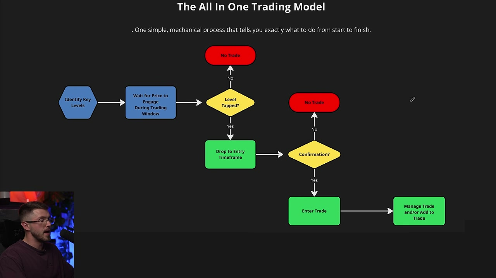
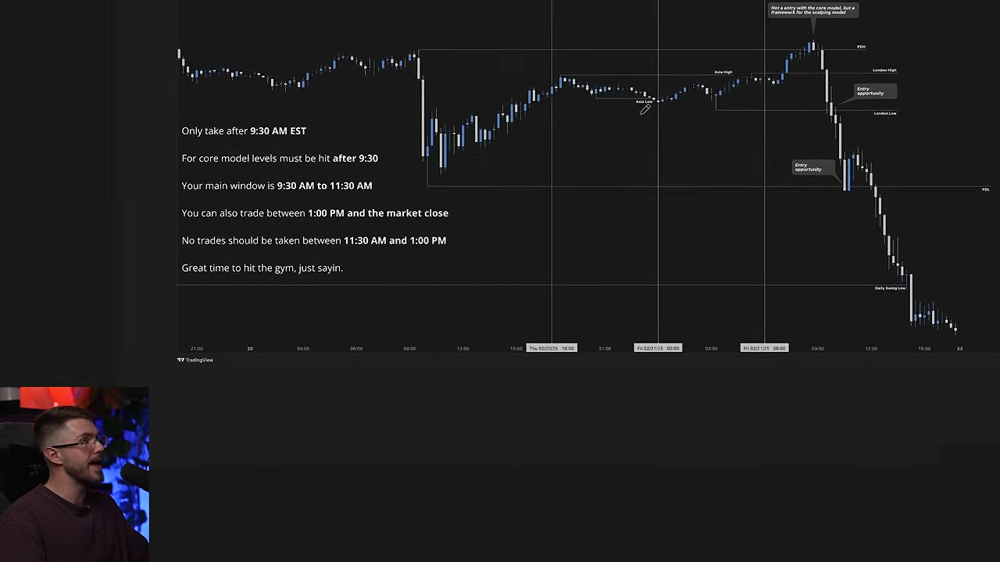
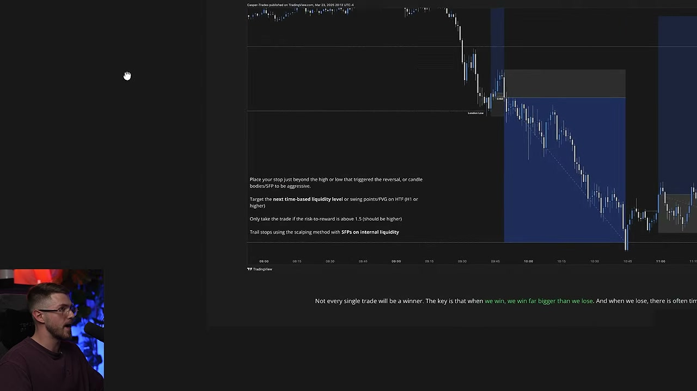
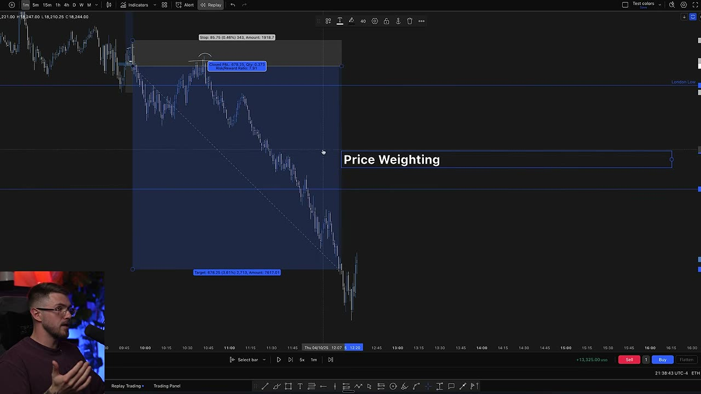

# 05 · The All-In-One Trading Model

*One simple, mechanical process that tells you exactly what to do from start to finish.* `[1:54]`

This is the strategy Jesse uses today, and the one behind the $46,000 shown at the start of the video. `[1:31]`



```
Identify key levels → Wait for price to engage during trading window → Level tapped?
   No  → NO TRADE
   Yes → Drop to entry timeframe → Confirmation?
            No  → NO TRADE
            Yes → Enter trade → Manage trade and/or add to trade
```

## Step 1 · Mark your key levels `[1:32] [1:54]`
Finish by **9:00 AM New York**. `[1:33]`

| Chart | Mark | Keep it until |
|---|---|---|
| **Weekly** | High and low of the previous candle | Traded through |
| **Daily** | High and low of the previous candle | Traded through |
| **15-minute** | **Asia** high/low (6 PM – 12 AM) and **London** high/low (12 AM – 6 AM) | Traded through |
| **H1 / H4 / Daily** | Swing points, FVGs, inflection points | Traded through |

Focus on levels that **have not yet been traded into**. Those are your live targets and reaction points. `[1:33]`

## Step 2 · Know your trading windows `[1:54]`


| New York time | Status |
|---|---|
| Before **9:30 AM** | **No entries.** Sitting out here raises your win rate |
| **9:30 – 11:30 AM** | **Main window** |
| **11:30 AM – 1:00 PM** | **No trades.** "Great time to hit the gym" |
| **1:00 PM – market close** | Tradeable |

## Step 3 · Choose the model

### Core model: the level is hit inside your window
**For the core model, the level must be hit after 9:30.** `[1:54]`

1. Price taps a key level after 9:30
2. Drop to the **1M or 5M**
3. Wait for **one valid confirmation**: IFVG, CISD or MSS
4. Enter on the **close** of the confirming candle `[1:39]`

### Scalping model: the level was hit before 9:30
A level hit pre-market is **not a core entry. It becomes the framework for the scalping model.** `[1:54]` The level has told
you the direction of travel: from this level to the next one. `[1:35] [1:37]`

1. Identify the move: *the level held, so we are going to the next level*
2. Wait for 9:30
3. **Require a run on liquidity:** a short-term point of structure gets swept **against** your direction. *You do not enter
   unless there is a run on liquidity.* A sweep into an FVG is a bonus `[1:35]`
4. Then require confirmation: **IFVG or CISD** `[1:36]`
5. Enter on the close

You never need to catch the top or bottom. This setup appears every day, so there is an abundance of trades. `[1:33]`

## Step 4 · Stop-loss `[1:37] [1:54]`


| Trade type | Stop placement |
|---|---|
| **Reversal at the level** (core model, first reaction) | **Just beyond the high or low that triggered the reversal** |
| **Between levels** (scalping model, move already underway) | **Candle bodies** or the SFP, for a tighter, more aggressive stop |

Why the difference: at the level you give the trade room. Between levels the move is already happening, so price should not
come back. `[1:38]`

## Step 5 · Target and the risk-to-reward check `[1:38] [1:54]`
- **Target:** the **next time-based liquidity level**, or swing points/FVGs on the **H1 or higher**
- **Only take the trade if risk-to-reward is above 1.5**, and it should usually be higher
- This strategy's high win rate is what makes 1.5R trades worthwhile `[1:38]`

## Step 6 · At the target, look again `[1:38] [1:39]`
Your target is the next key level, so the process restarts. Hit the London low → watch for a CISD → that can be your next
trade, back toward the nearest level above.

## Step 7 · Flip when the market tells you to `[1:40] – [1:42]`
You are long from a level. Immediately, a **bearish CISD** prints.

1. **Cut the long at your entry**
2. The level is failing, so the destination is the **next level** on your list
3. **Go short**, stop beyond the high, target the next level
4. Even if you hesitated and took the loss, the short is still valid

## Step 8 · Manage the winner

### Before the target: trail on stop runs `[1:42] [1:50]`
*Trail stops using the scalping method with **SFPs on internal liquidity**.* `[1:54]`

- In a short, when a **swing high gets manipulated** and price resumes down, move your stop beyond that high. There has been a
  stop run, and a healthy move should not need another one
- If price **pushes through** a high with strength, that high is not a valid trail point `[1:50]`
- Mirror this for longs with swing lows

### Adding to the trade `[0:46] [1:13] [1:54]`
Each stop run followed by a fresh confirmation is a place to **add** or re-enter, trading key level to key level.

### At the target: Price Weighting `[1:51]`


This simple change can lift your average win dramatically.

1. Price reaches the level where you would normally take profit
2. **Do not exit.** Trail your stop to each new swing on your **entry timeframe** (1M)
3. Every time a new swing high forms in a short (swing low in a long), move the stop again
4. **Let your stop-loss be your take-profit** `[1:53]`

Use it when the market is expanding. On Apr 10 2025 it turned a roughly **5R trade into an 8R trade**. If you did this on just
half of your winners, those bigger wins alone could carry your results. `[1:52]`

Almost all of Jesse's winning trades ran further than the original target. Check your own journal and see how far your winners
kept going without you. `[1:53] [1:54]`

## Step 9 · Daily limit `[1:43]`
**No more than two losses in a day.** After one loss, there is usually another opportunity to make it back and more.

## The complete decision tree

```
Is it inside a trading window (9:30–11:30 or 1:00–close NY)?
├─ No → WAIT
└─ Yes → Have I already taken 2 losses today?
   ├─ Yes → DONE FOR THE DAY
   └─ No → Was a key level tapped?
      ├─ Tapped after 9:30 → CORE MODEL
      │     One of IFVG / CISD / MSS on 1M–5M? ─ No → WAIT
      │     Stop beyond the high/low that triggered the reaction
      ├─ Tapped pre-market → SCALPING MODEL
      │     Short-term structure swept against me? ─ No → WAIT
      │     IFVG or CISD? ─ No → WAIT
      │     Stop at candle bodies / SFP
      └─ Not tapped → WAIT for price to come to you
            ↓
      Next level gives more than 1.5R? ─ No → SKIP
            ↓
      ENTER on the candle close
            ↓
      Opposite CISD against me? ─ Yes → EXIT, consider the FLIP to the next level
            ↓
      Swing manipulated in my favour? → TRAIL (add on fresh confirmation)
            ↓
      Target reached and market expanding? → PRICE WEIGHT, trail every new 1M swing
```

## Applying it to any market `[1:34]`
Jesse demonstrates on NASDAQ futures and states that **this works in any market**. The clock stays the same: New York time. The
level list stays the same. Swap in the correlated partner for your instrument from `10-cheatsheets-glossary.md`, for example
XAUUSD with XAGUSD, EURUSD with GBPUSD, and either of them against DXY.
