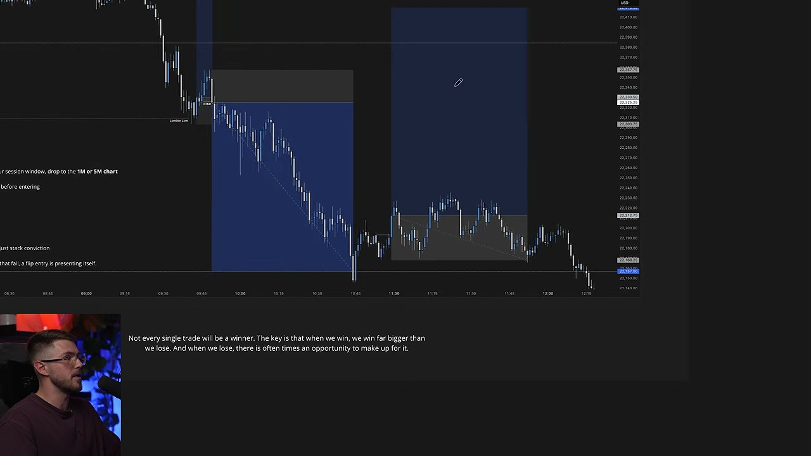
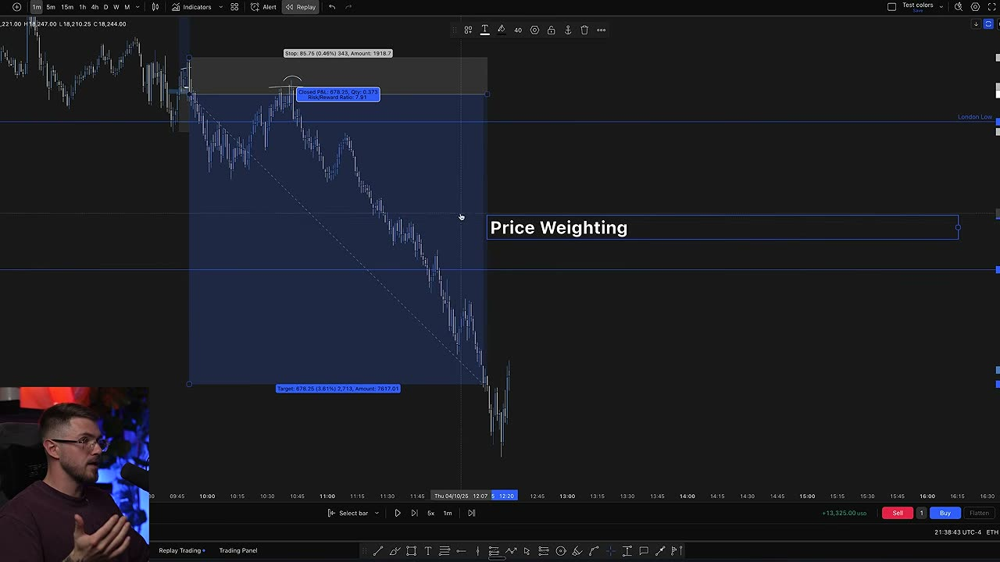

# 06 · Worked Trades

## Trade day 1: Friday Feb 21 2025, NQ, one contract, +$3,410 `[1:32] – [1:43]`

**Levels marked:** previous day high (PDH), previous day low (PDL), Asia high/low, London high/low, daily swing low. Asia high
and low were already traded into, and so was the London high. **Untouched: London low, PDL.**

**Pre-market:** price tapped the PDH, then printed an IFVG and a CISD. This is a beautiful signal, and the rules still say no entry
before 9:30. The PDH becomes the **framework**: we are moving from the PDH to the London low. `[1:34] [1:35]`

| # | Time (NY) | Trade | Why | Stop | Target | Result |
|---|---|---|---|---|---|---|
| 1 | ~9:36 | **Short** (scalping model) | Short-term high swept into an FVG, then a CISD | Candle bodies, ~24 pts | London low, ~42 pts (**1.73R**) | **+$830** |
| 2 | ~9:43 | **Long** (reversal) | London low hit, bullish CISD | Nearest swing low | Session high | **−$440**: bearish CISD appeared, so the level was failing |
| 3 | ~9:50 | **Short** (the flip) | London low failed, next level is the PDL | Above the high, ~49.5 pts | PDL, ~151 pts (**3.05R**) | **+$3,020** |

**Management on trade 3:** a swing high was manipulated on the way down, so the stop came down above it. `[1:42]`

**The lesson:** one small loss produced the best trade of the day. Candles said long, then flipped, and Jesse flipped with them.

## Trade day 2: Thursday Apr 10 2025, MNQ ×5, +$6,000.80 `[1:44] – [1:53]`

A live trade from Jesse's personal account during very volatile conditions, which is why micros were used.

**Scenarios mapped before the open:** `[1:45]`
- Price reaches the upper level and reverses → trade down to the London low
- Price reaches the upper level and flips → trade to the Asia high
- Price reaches the London low and reverses → trade higher
- Price reaches the London low and flips → trade lower

| # | Trade | Why | Result |
|---|---|---|---|
| 1 | **Long** from the London low | Level tapped, IFVG printed, targeting the London high | Small loss: a CISD against the trade plus a run of the high. Cut early, a fraction of the full stop |
| 2 | **Short**, the flip | Buyers had every chance and failed in one candle | **+600.7 points** |

**Trade 2 ticket:** entry 18,720.30, exit 18,119.60, opened 09:56:33, closed 12:18:24, net **$6,000.80**.

**Target logic:** no time-based level remained below, so Jesse went to the higher timeframe and used the **inflection point inside the
4H fair value gap**. `[1:48] [1:49]`

**Management:** a push through one high was ignored, because it was displacement. A later high was manipulated, so the stop moved
there. At the target, **price weighting** began, and the stop trailed each new 1M swing. Replay measurement: ~86-point stop, ~678
points captured, **7.91R**. `[1:50] – [1:53]`

## Journal day: Thursday Jan 30 2025, net +$8,080 `[1:07]`
Six trades, 4 winners, 2 losers, 66.67% win rate, profit factor 7.63, gross $8,125, commissions $45.

Jesse's actual pre-market notes, a template for your own:

**Weekly**
- New week's opening gap is likely to be tapped
- No wick on the weekly candle yet, so upward movement toward this level is likely, to create the wick

**H4**
- H4 FVG tapped pre-market
- Most recent H4 bearish FVG inverted
- Bullish overall

**H1 / M15**
- London low swept pre-market
- Bullish CISD on H1
- Inflection point aligning with the London low
- Buyers absorbing sellside at the London low and any breakeven liquidity at the IP

**Scenarios**
- Hold the current swing into the London high and trail stops into the NWOG
- Price trades higher into the NWOG, watch sweeps of M15 or H1 levels for an entry, target London high or NWOG
- Price rushes straight to the NWOG and reverses
- Price reverses from the London high
- Open to entries on either side of the market
- **Trade from key level to key level**

## More results shown `[0:01]`
| Date | Instrument | Side | Size | Net |
|---|---|---|---|---|
| Apr 4 2025 | NQ (NQM5) | Short | 1 | **$17,365.50** (868.5 pts) |
| Mar 17 2025 | NQ (NQH5) | Long | 3 | **$6,561.50** |
| Apr 10 2025 | MNQ (MNQM5) | Short | 5 | **$6,000.80** |
