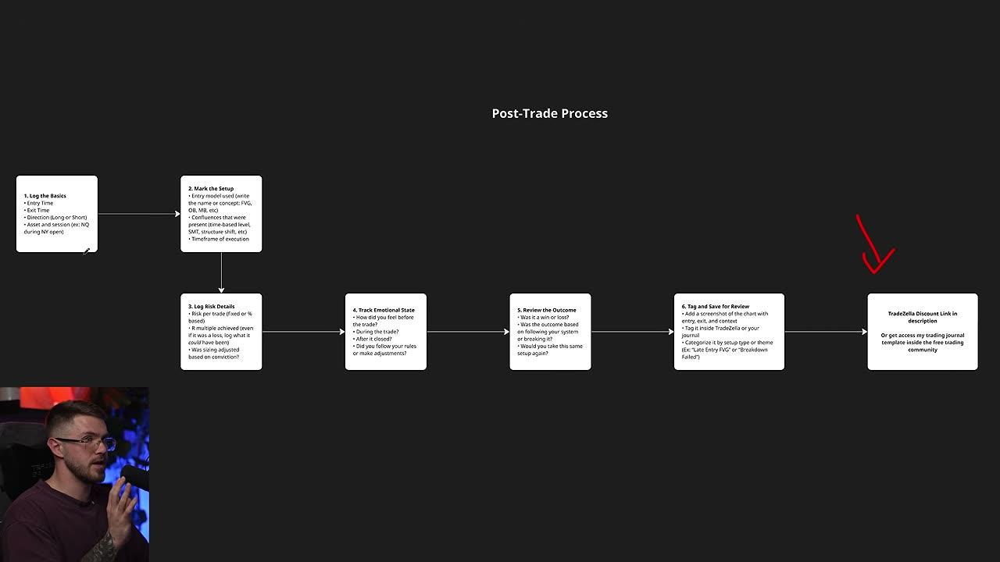

# 07 · The Daily Routine (Your SOP)

## The two things every profitable trader has `[0:54]`
Entries are only **10% of the game**.

| Standard Operating Procedure | Mechanical Strategy |
|---|---|
| **Everything outside of entry** that makes a trader profitable | Where you **execute mechanically**: entry model, trade management, playbook |
| Builds consistency before and after you touch the chart | Once locked in, you are not analysing, you are executing |
| Pre-trade, post-trade, marking levels, confirmation filters, risk settings, stop rules, psychology | No guessing, no decision fatigue, just doing what the system says |

> When trading becomes boring, you know you've made it. `[0:53]`

## Morning routine `[1:01]`
Jesse's daily list: wake up at 7 AM · gratitude · meditate · trade/study · followed trading plan · afternoon walk · read · gym.

**If your brain isn't ready, your trades won't be either. No sleep, no routine, no trade.** It does not have to be a three-hour
Goggins circuit. It has to be **intentional**, because it forms the identity of a professional.

## Pre-trade process: start 30 minutes before the open `[0:56]`
1. **Mark key levels**
2. **Understand conditions:** are we expecting expansion or chop? Are traders trapped from pre-market action?
3. **Check major news and earnings**
4. **Build two or more trade scenarios**
5. Decide what you are **risking today**

## News with Forex Factory `[0:56] – [1:00]`
On forexfactory.com, open the calendar filter, select only **red folder** impact, and select your currencies (**USD** if you trade
futures).

| Situation | Action |
|---|---|
| **Red folder day** | Likely more expansion, so you can lean into more risk |
| **No red folder** | Likely chop, so go in with less risk |
| **Right before the release** | **Do not be in a trade.** Stops can slip in thin liquidity |
| **Prop firm account** | Check the firm's news rules, since some fail you for trading the release |

**The big ones:** NFP, CPI, and the **FOMC rate decision** (2 PM). The FOMC minutes matter much less.

**Reading the numbers:**
- **Interest rates:** actual the same or lower than forecast → bullish. Higher → extremely bearish `[0:59]`
- **CPI:** lower than expected → bearish for the dollar → usually bullish for stocks. Year-over-year is the one to watch `[1:00]`

## Marking levels in TradingView `[1:02] – [1:05]`
1. **Weekly chart:** mark the previous candle's high and low
2. **Daily chart:** mark the previous candle's high and low, label them PDH and PDL
3. **Current week:** stay aware of the current week's high and low
4. **15-minute chart:** use the **vertical line** tool at **6 PM (previous evening), midnight and 6 AM New York**
   - 6 PM → midnight = **Asia**. Mark its high and low
   - Midnight → 6 AM = **London**. Mark its high and low
5. **1H, 4H, Daily:** mark swing points, FVGs and inflection points. Keep it clean, and just stay aware of the big ones

**Time-saver:** save line styles as **templates** (double-click a line → Template → Save as). Colour higher-timeframe levels so you
recognise them instantly on the 1-minute. Jesse uses purple for weekly and daily levels. `[1:03]`

> Jesse's session times are chosen deliberately for what works, and differ from textbook session definitions. Use them as given. `[1:04]`

## Trading plan checklist `[0:52]`
**Marking key levels:** swing points, inflection points and FVGs on Weekly, Daily, H1 and M15, plus time-based levels.

**Planning scenarios:**
- Determine multiple different scenarios
- Don't be biased
- Have contingencies: what do you do if your plan is wrong?

## Scenarios, not bias `[1:06]`
1. Having a bias is the fastest way to blind yourself to what the market is actually doing
2. The market doesn't owe you your plan. **Your job is to react, not predict**
3. Once you lock into a bias, your brain filters for confirmation and ignores contradiction
4. Stop guessing what price should do, and start asking what happens if it does the opposite
5. You **can lean** in one direction to adjust risk, but it should never stop you from flipping sides

**A scenario sounds like:** *"If price reaches X and reverses, I trade to Y. If price reaches X and flips, I trade to Z."*

## Post-trade process `[1:09]`

1. **Log the basics:** entry time, exit time, direction, asset and session
2. **Mark the setup:** entry model (FVG, OB, MB), confluences present (time-based level, SMT, structure shift), execution timeframe
3. **Log risk details:** risk per trade, R multiple achieved (even if it was a loss, log what it *could* have been), whether sizing
   was adjusted on conviction
4. **Track emotional state:** before, during and after the trade. Did you follow your rules?
5. **Review the outcome:** win or loss, did the outcome come from following the system, would you take this setup again?
6. **Tag and save:** screenshot with entry, exit and context, categorised by setup or theme (e.g. "Late Entry FVG", "Breakdown Failed")

### Filter your data: this is where profit is found `[1:09] [1:10]`
Journaling pays when you **filter**.
- **By setup:** what is the win rate of IFVG entries versus order block entries?
- **By time of day:** if half your losses come between 9:45 and 10:00, skip that slot and you may become profitable overnight
- **By emotional state**
- **By bias:** see `09-mindset-journey.md`

Jesse became profitable by **removing** things the data exposed: certain times, certain setups, daily bias. `[2:02]`
