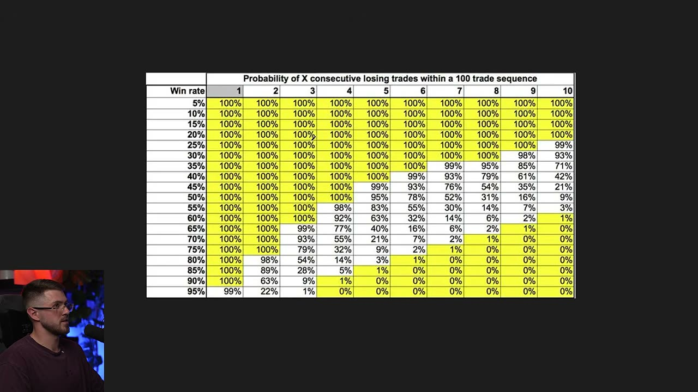
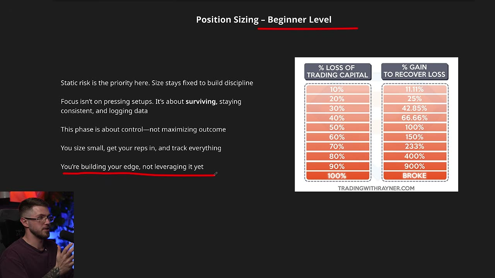

# 08 · Risk Management

**The one thing you can't ignore.** Every trader goes through losses, even doing everything right. Risk management is what makes
those losses harmless and lets the edge pay you. `[1:25]`

Jesse recently took **six losses in a row while trading live**, barely lost money, and made it back quickly, purely because of knowing
when to take the foot off the gas. `[1:25]`

## The two pillars `[1:27]`
1. **Position sizing:** how much you allocate to each trade **based on the quality of the setup**. This does not mean "risk 1%"
2. **Capital protection rules:** how much you are allowed to lose in a day, and how many trades you are allowed to take

Get either one wrong and the system breaks.

**The components:** dynamic position sizing · daily loss limits · trailing stops. `[1:26]`

## Position sizing by level `[1:27] – [1:30]`

### Beginner: survive and collect data
- **Static risk.** Size stays fixed to build discipline
- Size small: a cheap prop account and **one micro contract** is ideal
- The goal is surviving, staying consistent, logging data and finding your weaknesses
- *You're building your edge, not leveraging it yet*

### Intermediate: size by probability
- You have data, so you begin **grading your setups**
- Every trade still follows structure, and **sizing reflects your conviction**
- You're learning to trust your edge without overstepping it

**Heavier trade:** you lean bullish, it is a red folder day, price moves into a low, and you get multiple confirmations.
**Lighter trade:** no red folder, one confirmation, no big move into the level. `[1:28] [1:29]`

### Expert: precision-guided sizing
- Size is guided by **experience, data and intuition**
- You identify setups instantly and act without hesitation
- You press the gas hard when it is time, and step back when it is not
- **Feeler position:** a very tight stop with a far target deserves just one contract. Little to lose, and a large win if it works `[1:30]`

## Daily limits `[1:43]`
- **Maximum two losses in a day**
- After one loss, stay open: there is usually another opportunity to recover it and more
- Protecting your bankroll is everything in this business

## Losing streaks are normal `[1:26]`

Probability of **at least X consecutive losses within 100 trades**:

| Win rate | 2 | 3 | 4 | 5 | 6 | 7 | 8 | 9 | 10 |
|---|---|---|---|---|---|---|---|---|---|
| 40% | 100% | 100% | 100% | 100% | 99% | 93% | 79% | 61% | 42% |
| 45% | 100% | 100% | 100% | 99% | 93% | 76% | 54% | 35% | 21% |
| 50% | 100% | 100% | 100% | 95% | 78% | 52% | 31% | 16% | 9% |
| 55% | 100% | 100% | 98% | 83% | 55% | 30% | 14% | 7% | 3% |
| 60% | 100% | 100% | 92% | 63% | 32% | 14% | 6% | 2% | 1% |
| 65% | 100% | 99% | 77% | 40% | 16% | 6% | 2% | 1% | 0% |
| **70%** | 100% | **93%** | 55% | 21% | 7% | 2% | 1% | 0% | 0% |
| 75% | 100% | 79% | 32% | 9% | 2% | 1% | 0% | 0% | 0% |
| 80% | 98% | 54% | 14% | 3% | 1% | 0% | 0% | 0% | 0% |

Even a 70% win rate has a **93% chance** of a three-loss streak. Long-term, Jesse's win rate is about **55–65%**, and that is extremely
profitable with this method. When a streak arrives, nothing is broken. It is just the math playing out.

## Why protecting capital matters `[1:27]`

| Loss | Gain needed to recover |
|---|---|
| 10% | 11.11% |
| 20% | 25% |
| 30% | 42.85% |
| 40% | 66.66% |
| 50% | 100% |
| 60% | 150% |
| 70% | 233% |
| 80% | 400% |
| 90% | 900% |
| 100% | Broke |

## Slippage `[0:58]`
A stop can fill worse than planned when a fast candle runs through it, most often around red folder news when liquidity thins out.
Be flat before major releases.

## Trailing as risk control `[1:42] [1:43]`
Moving your stop after each stop run removes risk far earlier than most traders realise, and takes much of the sting out of losing.

## Prop firm notes
- Start on a **very cheap prop account** with one micro while building your edge `[1:28]`
- Know each firm's **news rules** `[0:57]`
- Most prop traders work the 1-minute and 5-minute charts, and need the system rather than a daily bias `[1:01]`
- Expect to lose an account at some point, accept that up front, and keep following the process `[1:59]`

## What Jesse's team has achieved `[1:55] [2:04] – [2:06]`
- **Jayden:** from $80,000 down to **$270,000+** profit in 2024 with a $250k funded account, crediting journaling most of all
- **Brick:** approved for a **$40k payout**, up $120k across accounts
- **Jasmine:** **$36,000 payout** within four months and #1 on a prop firm leaderboard
- **Shawn:** first payout after seven years of trying
- **"Trader Mom":** now making **$6,000 in a single trade**, starting at home with a newborn
- **Kios:** up $5,600 in a day plus a $14k payout on the way
- **Chong:** brand new, securing a third payout within months
