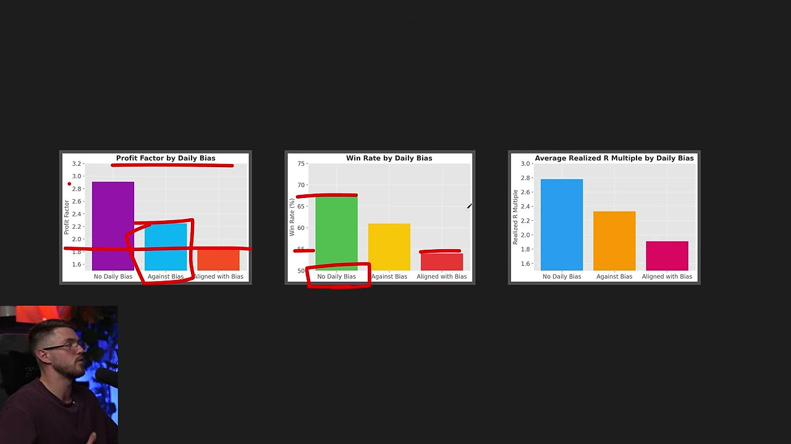

# 09 · Mindset & The Journey

## The data that changed everything: drop the daily bias `[1:19]`

From **400+ of Jesse's tagged trades** (values read from the charts):

| Trade tag | Win rate | Profit factor | Avg realised R |
|---|---|---|---|
| **No daily bias** | **~68%** | **~2.9** | **~2.8R** |
| Against bias | ~61% | ~2.25 | ~2.3R |
| Aligned with bias | ~54% | ~1.85 | ~1.9R |

Removing daily bias added almost a full point of profit factor. Jesse was even more profitable trading **against** the bias than with it.
This came out of the journal, and without the data it would have stayed hidden. `[1:20]`

## The IKEA effect `[1:21]`
You love what you build, even when it is flawed. In trading the loop looks like this:

1. **Build a plan**
2. Trust it because you put effort into it
3. The market moves opposite to the plan
4. You stick to it and double down on your bias
5. You hesitate, expecting the market to reverse
6. You ignore every sign you are wrong
7. You take a loss or miss a winner
8. *"It's ok, I followed my plan"*
9. Frustrated, you switch strategies and **restart the cycle**

**Break the loop by redefining the words:** `[1:22]`

| | Common misconception | Reality |
|---|---|---|
| **What is a plan?** | Predicting the market's direction | **Managing risk around multiple scenarios** |
| **What makes a plan good?** | It turned out right | **It provides a high probability of success** |
| **What is success?** | Being right more than you are wrong | **Profits, long term** |

## The Lindy effect `[1:23]`
The longer an idea has been repeated, the more people assume it must be true. "You need a daily bias" survives on repetition. Its original
meaning was probably closer to *have scenarios and know what to do when you are wrong*.

Of 100 traders starting today, 90 blow up in year one, 9 of the remaining 10 break even or slowly bleed, and **1 truly makes it**. So why do
what most traders do? `[1:24]`

## You don't have a psychology problem, you have a clarity problem `[0:27] [1:15]`
Hesitation, freezing and overtrading mostly come from not having a clear-cut way of doing things. A mechanical system dissolves them. Fear turns
into abundance once you understand that a sound loss at a key level is often the doorway to the next trade.

> **I don't care if I'm right. I only care if I make money.** `[1:19]`

## Winning the mental game `[1:56] – [2:03]`
The new strategy is only part of the story. What decides your outcome is the voice that tells you to close early, overtrade and break your rules.

**The root cause: you place too much importance on making it work.**
Needing this trade, this day, this account, or success within three months creates the fear that sabotages you. So:

1. **Accept that losses will come.** You will lose trades, days, and even funded accounts. Everyone you look up to has
2. **Remove the importance.** Zoom out, and stop demanding results on a deadline
3. **Perfect the process.** Focus on executing well, and the money follows
4. **Subtract.** Profitability came from taking things away, using a sensible review of the journal `[2:02]`
5. **Never lose sight of the goal.** Hard stretches are part of the path `[2:07]`

Boring is the destination. Once it is systematic, trading stops being exciting, and that is exactly what success feels like. `[0:53]`

**Be your own trader:** *"Take what is useful, discard what isn't, and add what is your own."* — Bruce Lee `[1:14]`

## Jesse's journey `[0:00] [1:57] – [2:01]`
- Started trading in **2016** after getting lucky in crypto
- Made hundreds of thousands, then lost it all
- Faced serious legal trouble, with trading as the way forward
- **DoorDashed deliveries to fund a $100 account**
- About **four years** of work to reach consistent profitability
- Went on to make millions, get funded with multiple prop firms, have multiple six-figure months, and retire both parents

The struggle does not have to take that long for you. You have the complete map from day one.

## Your road map
*This guide's summary of the path the video describes.*

| Stage | Focus | Move on when |
|---|---|---|
| **1. Learn** | Pages 01–04. Spot displacement, manipulation, FVGs and CISDs on replay | You can mark levels and name signals without hesitation |
| **2. Practise** | Page 05 on replay, one model at a time. Journal every trade | You execute the rules without improvising |
| **3. Survive** | Cheap prop account, one micro, static risk | You are consistent and your data is growing |
| **4. Refine** | Filter the journal. Remove your worst times and setups | You can grade setups from your own data |
| **5. Scale** | Size by conviction, price-weight winners, grow funded accounts | Keep going. This is the bull market of your career `[0:51]` |

Once you become profitable, it is the biggest bull market you've ever seen. `[0:51]`
