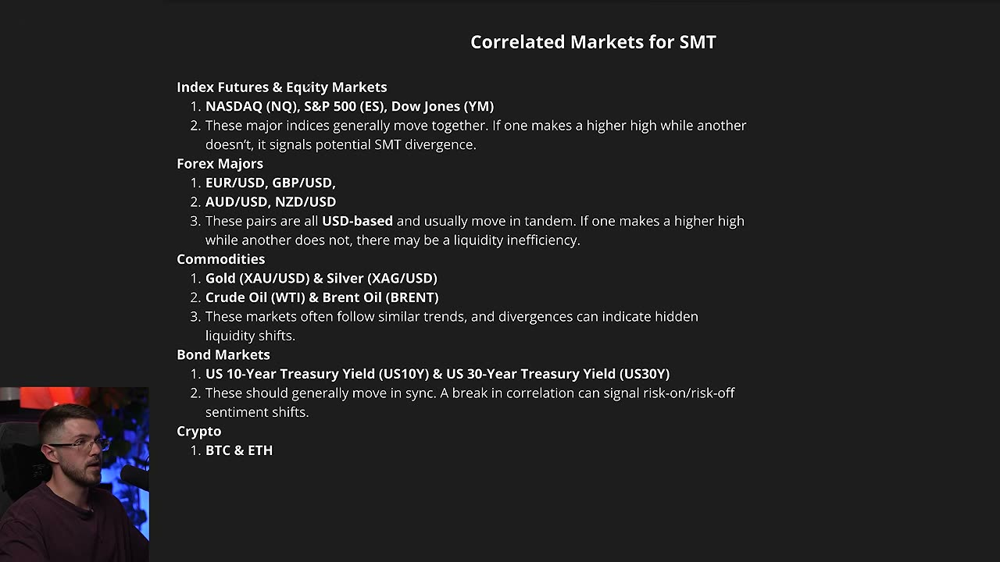
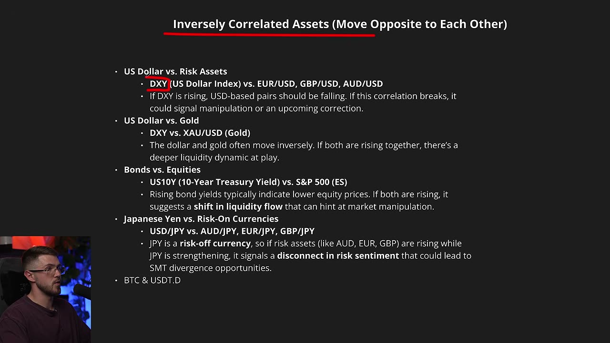

# 10 · Cheat Sheets & Glossary

## One-page daily checklist

**Before the open**
- [ ] Slept well, routine done
- [ ] Red folder news checked, flat before any release
- [ ] Expansion or chop? Today's risk decided
- [ ] Weekly, daily, Asia and London levels marked by 9:00 NY
- [ ] H1/H4/Daily FVGs, swings and IPs noted
- [ ] Two or more scenarios written, reversal **and** flip for each level
- [ ] No daily bias

**Before every entry**
- [ ] Inside a window: 9:30–11:30 or 1:00–close NY
- [ ] Fewer than two losses today
- [ ] Key level tapped (core model) or level framework + run on liquidity (scalping model)
- [ ] One valid confirmation on 1M/5M: IFVG, CISD or MSS
- [ ] Stop placed: beyond the triggering high/low, or bodies/SFP when between levels
- [ ] Target is the next time-based level or H1+ swing/FVG
- [ ] Risk-to-reward above 1.5R

**In the trade**
- [ ] Opposite CISD → exit, consider the flip
- [ ] Manipulated swing → trail the stop
- [ ] Fresh confirmation → option to add
- [ ] Target hit and market expanding → price weight

**After the trade**
- [ ] Journal: setup, confluences, time, R, emotions, screenshot, tag

## Timetable (New York)

| Time | What |
|---|---|
| 6:00 PM (prior day) – 12:00 AM | **Asia session** |
| 12:00 AM – 6:00 AM | **London session** |
| 9:00 AM | Levels marked, 30 minutes of prep before the open |
| 9:30 – 11:30 AM | **Main trading window** |
| 11:30 AM – 1:00 PM | **No trades** |
| 1:00 PM – close | Second window |
| 2:00 PM (on FOMC days) | Rate decision |

## Correlated markets for SMT `[0:44]`

| Group | Pairs |
|---|---|
| **Index futures** | NASDAQ (NQ), S&P 500 (ES), Dow Jones (YM) |
| **Forex majors** | EUR/USD with GBP/USD; AUD/USD with NZD/USD |
| **Commodities** | Gold (XAU/USD) with Silver (XAG/USD); WTI with Brent |
| **Bonds** | US10Y with US30Y |
| **Crypto** | BTC with ETH |

## Inversely correlated markets `[0:44]`

| Pair | Normal behaviour | A break suggests |
|---|---|---|
| **DXY vs EUR/USD, GBP/USD, AUD/USD** | DXY rising, USD pairs falling | Manipulation or an upcoming correction |
| **DXY vs XAU/USD** | Move inversely | A deeper liquidity dynamic if both rise |
| **US10Y vs ES** | Rising yields, lower equities | A shift in liquidity flow if both rise |
| **USD/JPY vs AUD/JPY, EUR/JPY, GBP/JPY** | JPY is the risk-off currency | A disconnect in risk sentiment, an SMT opportunity |
| **BTC vs USDT.D** | Listed on the slide | |

## Contract math `[1:47]`
Five micros equal half of one mini, since a micro is one-tenth of a mini.

## Glossary

| Term | Meaning |
|---|---|
| **BSG** | Break-in-structure gap: an FVG that displaced through a lot of structure |
| **Buyside liquidity** | Orders resting above highs |
| **CISD** | Change in the state of delivery: a candle closes through and engulfs the opposing bodies at a key level |
| **Confirmation** | The signal at a key level that tells you to act |
| **Core model** | Entry at a key level tapped after 9:30, with one valid confirmation |
| **Displacement** | An energetic move through a swing point that leaves an FVG |
| **ERL** | External range liquidity: the highs and lows of a range |
| **Feeler** | A very small position on a tight-stop, far-target idea |
| **FVG** | Fair value gap: a three-candle gap between the wicks of candles 1 and 3 |
| **Flip** | A level fails, so you trade through it to the next level |
| **HTF / LTF** | Higher / lower timeframe |
| **IFVG / iFVG** | Inverted fair value gap: an FVG closed through the wrong way |
| **IP** | Inflection point: breakeven liquidity at broken swing points inside a BSG |
| **IRL** | Internal range liquidity: levels inside a range, mainly FVGs |
| **Key level** | A place you are willing to do business |
| **Liquidity** | The ease at which an asset is bought or sold; where orders cluster |
| **Manipulation** | A poke through a swing point that fails, leaving no FVG |
| **MMXM / MMBM** | Market maker model / market maker buy model |
| **MSS** | Market structure shift: a key level hit, then a low or high taken with displacement |
| **NWOG** | New week opening gap |
| **OB** | Order block: the last opposing candle before a forceful shift in delivery |
| **PDH / PDL** | Previous day high / low |
| **Premium / discount** | Above / below the 0.5 of the impulse |
| **Price delivery** | Whether price is currently seeking highs or lows |
| **Price weighting** | At the target, keep the trade and trail the stop to each new swing |
| **R / R multiple** | Profit or loss measured in units of initial risk |
| **Red folder** | High-impact news on Forex Factory |
| **Reversal** | A level holds and price moves away from it |
| **Run on liquidity** | A swing point swept, taking the stops beyond it |
| **Scalping model** | Entry between levels after a run on liquidity plus an IFVG or CISD |
| **Sellside liquidity** | Orders resting below lows |
| **SFP** | Swing failure pattern: trades beyond a swing point but cannot close beyond it |
| **SMT** | Divergence between correlated markets at a high or low |
| **SOP** | Standard operating procedure: everything outside of entry |
| **Swing high / low** | A candle with a lower high / higher low on each side |
| **Time-based liquidity** | Highs and lows of the week, day and sessions |
| **Trapped traders** | Traders on the wrong side, whose exits fuel the move |
